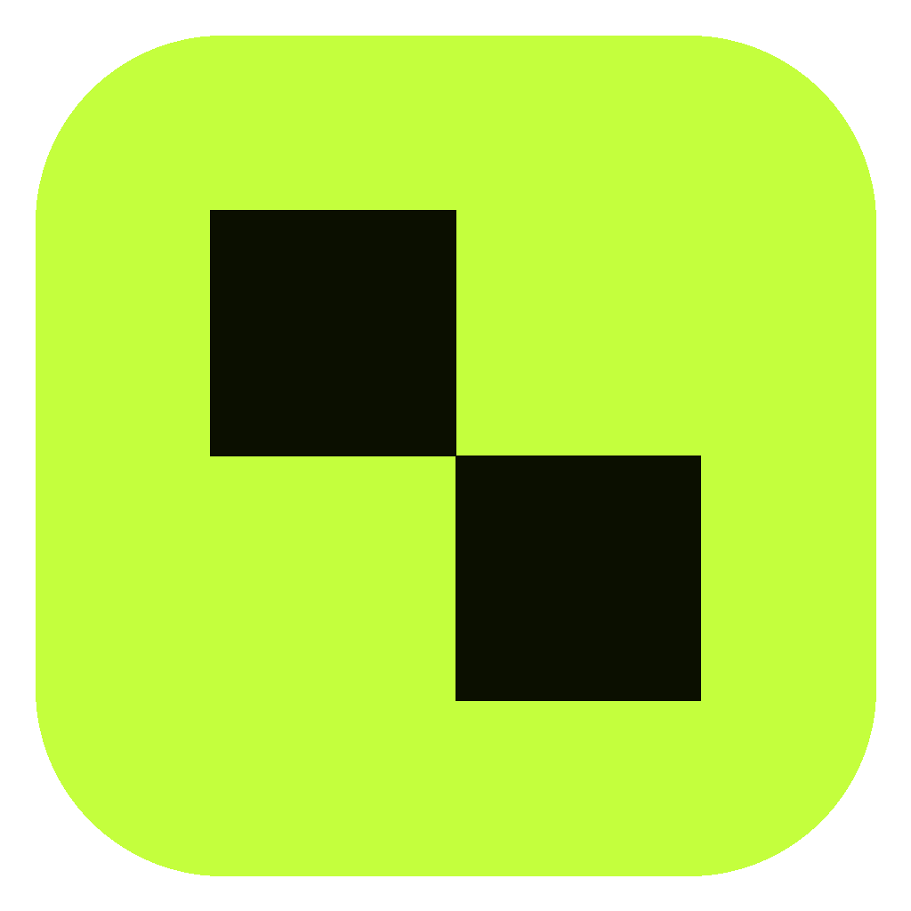
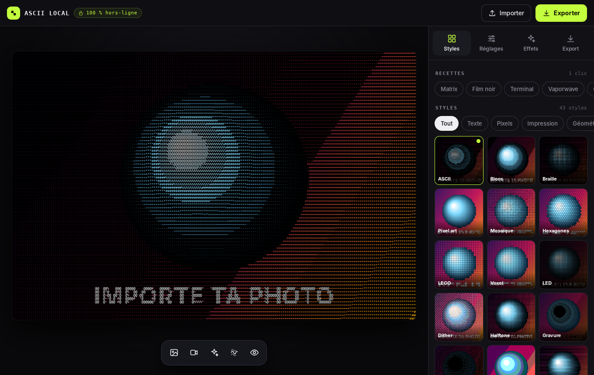
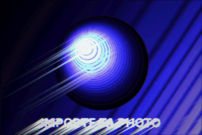
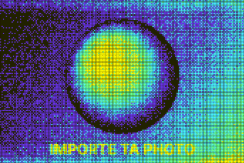

<div align="center">



# ASCII Local

**Transforme tes photos et vidéos en art ASCII, dither, glitch, verre… et anime-les en GIF.**
**100 % hors-ligne : tes images ne quittent jamais ton appareil.**

Windows · macOS · Android · Web (iPhone)



 

</div>

---

## Ce que ça fait

- **44 styles** : ASCII (18 jeux de caractères), blocs, braille, pixel art, mosaïque, hexagones, LEGO, voxel, LED, dither (Game Boy, PICO‑8, C64, Mac 1984…), halftone, gravure, pointillisme, Warhol, duotone, thermique, pixel sort, anaglyphe 3D, kaléidoscope, **16 effets de verre** (WebGL)…
- **Glitch machine** : traînées lumineuses directionnelles + lignes de contour qui « coulent ».
- **Matrice pop** : LED carrées tramées sur palette acide.
- **Animation de photo** : un clic sur 〰 et la photo s'anime en boucle parfaite → export **GIF** ou **vidéo MP4/WebM**.
- **Vidéos et caméra** : les effets s'appliquent en direct, export de la vidéo stylisée.
- Déformations (tourbillon, sphère, ondulation…), flous (tilt‑shift, mouvement…), bloom, scanlines, aberration chromatique, glitch, grain, vignette.
- **Créer** : 12 moteurs génératifs (donut 3D, cube, sphère, nœud, pyramide, Matrix, plasma, jeu de la vie, feu, flux, étoiles, tunnel), mode **texte** (remplissages 3D, Matrix, plasma…), 15 **looks animés** en shaders (aurore, fumée, mercure, or liquide, cymatique, Escher, encre, terrazzo, néon…), **fonte** et **feu** sur ta photo, et un **fluide interactif** qui remue ta photo sous ton doigt — le tout passe ensuite dans n'importe quel style.
- Réaction au curseur, export **ANSI** (terminal couleur), bannière **Markdown**, lien de réglages partageable.
- **41 recettes** en un clic, comparaison avant/après, export PNG jusqu'à ×4, texte ASCII copiable.

## Sur téléphone

L'interface mobile reprend les gestes de Lightroom, Snapseed et VSCO :

| Geste | Action |
|---|---|
| **Toucher l'image** | masquer / afficher les outils (plein écran) |
| **Appui long sur l'image** | voir l'original |
| **Glisser ← → sur l'image** | régler le paramètre choisi (ou changer de style / de recette) |
| **Glisser ↑ ↓ sur l'image** | passer au réglage précédent / suivant |
| **Curseur** | suit le doigt sans sauter ; **−/+** pour le pas fin ; **double‑toucher** pour réinitialiser |

**Importer** ouvre la galerie photos, les vidéos, l'appareil photo, la caméra en direct ou les fichiers. Dans l'appli Android, l'accès aux photos et vidéos est demandé par la fenêtre d'autorisation du système.

## Confidentialité

Tout tient dans un seul fichier, [`src/index.html`](src/index.html), sans aucune bibliothèque externe.

- Une **Content‑Security‑Policy** interdit au navigateur toute connexion vers Internet (`connect-src` n'autorise que le canal local `ipc` utilisé par l'application de bureau).
- Les images exportées ne contiennent **plus de métadonnées** (position GPS, modèle d'appareil…).
- Le code fait ~1 700 lignes commentées en français : tu peux tout vérifier.

## Installer

Télécharge la dernière version dans **[Releases](../../releases/latest)**.

| Système | Fichier | Premier lancement |
|---|---|---|
| **Windows** | `ASCII Local_x.x.x_x64-setup.exe` | Si SmartScreen s'affiche : *Informations complémentaires* › *Exécuter quand même*. |
| **Mac M1/M2/M3/M4** | `ASCII Local_x.x.x_aarch64.dmg` | Glisse l'appli dans *Applications*, puis **clic droit › Ouvrir** la première fois. Si macOS dit que l'appli est endommagée : `xattr -cr "/Applications/ASCII Local.app"` dans le Terminal. |
| **Mac Intel** | `ASCII Local_x.x.x_x64.dmg` | Pareil. |
| **Android** | `ASCII-Local.apk` | Ouvre le fichier sur ton téléphone et autorise l'installation d'applications inconnues. Les exports vont dans *Documents › ASCII Local*. |
| **iPhone (simple)** | https://borism-afk.github.io/ascii-local/ | Ouvre le lien dans **Safari** › bouton Partager › *Sur l'écran d'accueil*. L'appli s'installe avec son icône et marche **hors connexion**. |
| **iPhone (app)** | `ASCII-Local-iPhone.ipa` | Non signée : à installer avec [AltStore](https://altstore.io) ou [Sideloadly](https://sideloadly.io) et un identifiant Apple gratuit (à renouveler tous les 7 jours). L'App Store demande le programme développeur Apple (99 €/an). |

> Les avertissements Windows/macOS sont normaux : l'appli n'est pas signée avec un certificat payant (Apple : 99 $/an, Windows : ~200 €/an).

## Publier une nouvelle version

Les installateurs sont construits automatiquement par **GitHub Actions** à chaque push sur `main` : en ~15 minutes, la Release de la version en cours est créée (ou mise à jour) avec les fichiers Windows, Mac et Android.

Pour publier une **nouvelle version**, change `"version"` dans `src-tauri/tauri.conf.json` (et `package.json`), puis pousse : le tag `vX.Y.Z` et la Release sont créés tout seuls.

**Version web** : *Settings* › *Pages* › Source : **GitHub Actions** (une seule fois). Elle sera en ligne sur `https://<ton-pseudo>.github.io/ascii-local/`.

## Développer

L'application elle‑même ne demande aucune installation : ouvre `src/index.html` dans Chrome, Edge ou Firefox.

Pour les applis natives :

```bash
npm install
npm run dev              # appli de bureau (Tauri 2) — nécessite Rust : https://rustup.rs
npm run build:desktop    # installateur pour ton système

npm run android:init     # crée le projet Android (Capacitor) — nécessite Android Studio
npm run android:sync     # copie src/ dans le projet Android
npm run android:open     # ouvre Android Studio pour lancer sur ton téléphone
```

### Structure

```
src/index.html                 l'application complète (HTML + CSS + JS)
src-tauri/                     emballage bureau (Windows, macOS, Linux) avec Tauri 2
capacitor.config.json          emballage Android avec Capacitor
.github/workflows/release.yml  compilation automatique + Release
.github/workflows/pages.yml    version web sur GitHub Pages
```

### Ajouter un style

1. Écris une fonction `monStyle(o, W, H, sc)` qui dessine dans le canvas `o` (tu peux lire l'image source via `sample(cols, rows)` ou `SRC`).
2. Ajoute‑la dans l'objet `STYLES`, puis dans `STYLE_GROUPS` pour qu'elle apparaisse dans la galerie.
3. Pour qu'elle bouge en mode animation, utilise `ANIM.phase` (de 0 à 1 sur une boucle) quand `ANIM.on` est vrai.

## Signature du code

Free code signing provided by [SignPath.io](https://about.signpath.io), certificate by [SignPath Foundation](https://signpath.org).

Les installateurs Windows sont construits par GitHub Actions. La signature du code via SignPath est en cours de mise en place : en attendant, ils ne sont pas encore signés. Détails, rôles de l'équipe et politique de confidentialité : [CODE_SIGNING.md](CODE_SIGNING.md).

## Contribuer

Les contributions sont les bienvenues par pull request. Merci de respecter le [code de conduite](CODE_OF_CONDUCT.md).

## Licence

[MIT](LICENSE) — utilise, modifie et redistribue librement.

Inspiré par l'outil en ligne ascii-magic.com et par le travail de l'artiste decayingsun ; aucun code ni ressource de ces projets n'est utilisé.
